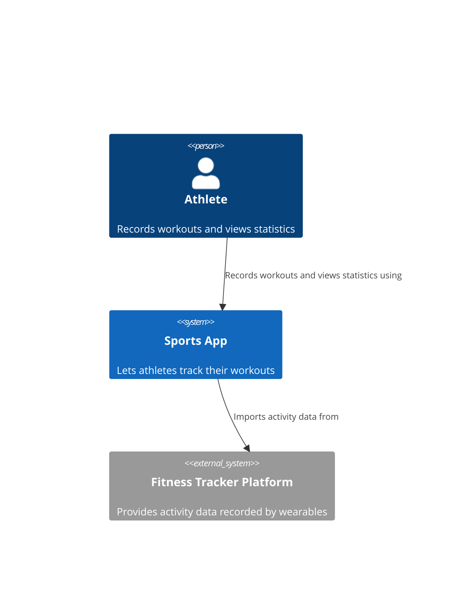

# System Context Diagram

## What
A system context diagram shows a single software system with people and software systems interacting with it in a high-level view [@brown2026, chap. 3].

## Audience 
Technical and non-technical people, everybody involved in the project [@brown2026, chap. 3]

## Content 

Software systems, people and relationships [@brown2026, chap. 3, "Content" section]

### People

People who are using the system (prefered from a functional perspective) labeled with a name and a description [@brown2026, chap. 3, "People" section].

### Software systems

The software system that is described and the software systems that interact with it. Every software system, should be labeled with a name and a description [@brown2026, chap. 3, "Software systems" section].

### Relationships

Relationships should be created as "unidirectional arrows, each labeled with a summary of the relationship" [@brown2026, chap. 3, "Relationships" section]. 

## Example

