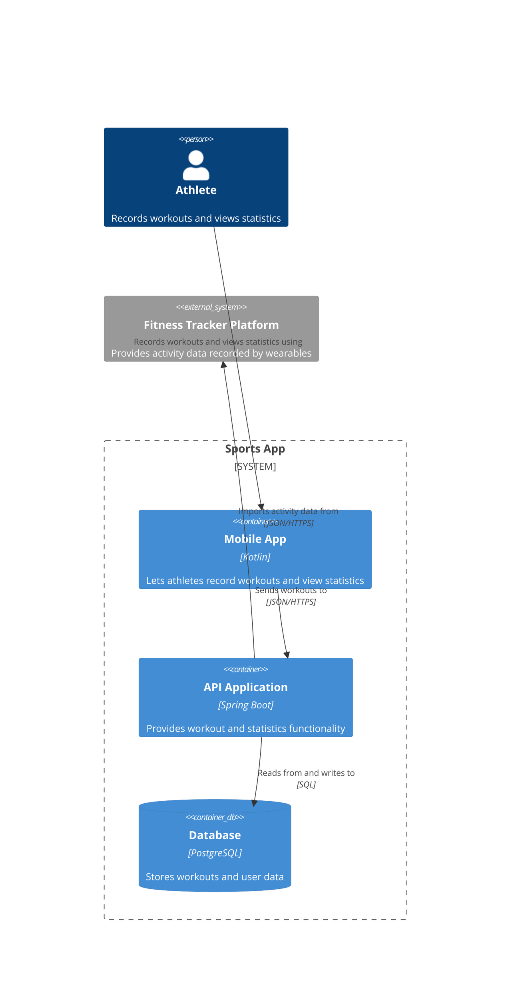

# Container Diagram

## What
A container diagram shows the containers of a single software system [@brown2026, chap. 4].

## Audience 

Software architects and engineers [@brown2026, chap. 4, "Audience" section]

## Content

### People

People who are using a container of the software system (prefered from a functional perspective) labeled with a name and a description [@brown2026, chap. 4, "People and software systems" section].

### Software Systems

The software systems that interact with a container of the software system [@brown2026, chap. 4, "People and software systems" section].

### Containers

Applications and data stores that are needed in order to have a working system. Every container should have the following informations: Name, technology and description [@brown2026, chap. 4, "Containers" section].

### Software system boundaries

The diagram should contain a box around containers to distinguish what is inside of the system [@brown2026, chap. 4, "Software system boundary" section].

### Relationships

The diagram should contain unidirectional arrows between containers, people and outside software systems. Each arrow should be labeled with a description and where applicable the technology [@brown2026, chap. 4, "Relationships" section].

## Example

