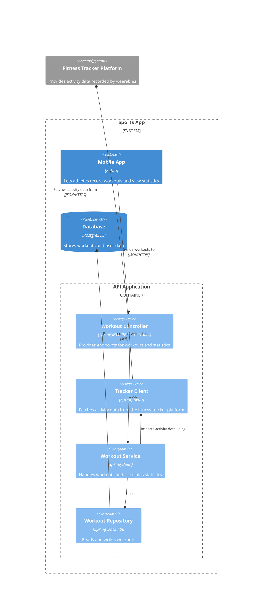

# Component Diagram

## What
A component diagram shows the components of a single container in a software system [@brown2026, chap. 5].

## Audience
Software architects and engineers [@brown2026, chap. 5, "Audience" section].

## Content

### People

The people that surround the container in the container diagram [@brown2026, chap. 5, "People, software systems, and containers" section].

### Software systems

The software systems that surround the container in the container diagram [@brown2026, chap. 5, "People, software systems, and containers" section].

### Containers

The other containers that surround the container in the container diagram [@brown2026, chap. 5, "People, software systems, and containers" section].

### Components

Components are the building blocks inside the container, each labeled with a name, technology and description. A component is a group of related code. The diagram should reflect the architectural style in use, e.g. components organized in layers or in a "ports and adapters" style [@brown2026, chap. 5, "Components" section]. 

### Container boundary

A box that shows the container boundary around the components [@brown2026, chap. 5, "Container boundary" section]. 

### Software system boundary (optional)

A box that shows the boundary of the parent software system to make the hierarchy of elements explicit [@brown2026, chap. 5, "Software system boundary" section]. 

### Relationships

The diagram should contain unidirectional arrows between the components, containers, people and outside software systems. Each arrow should be labeled with a description and where applicable the technology. Component to component relationships with method and function calls do not need technology description [@brown2026, chap. 5, "Relationships" section]. 

## Example

