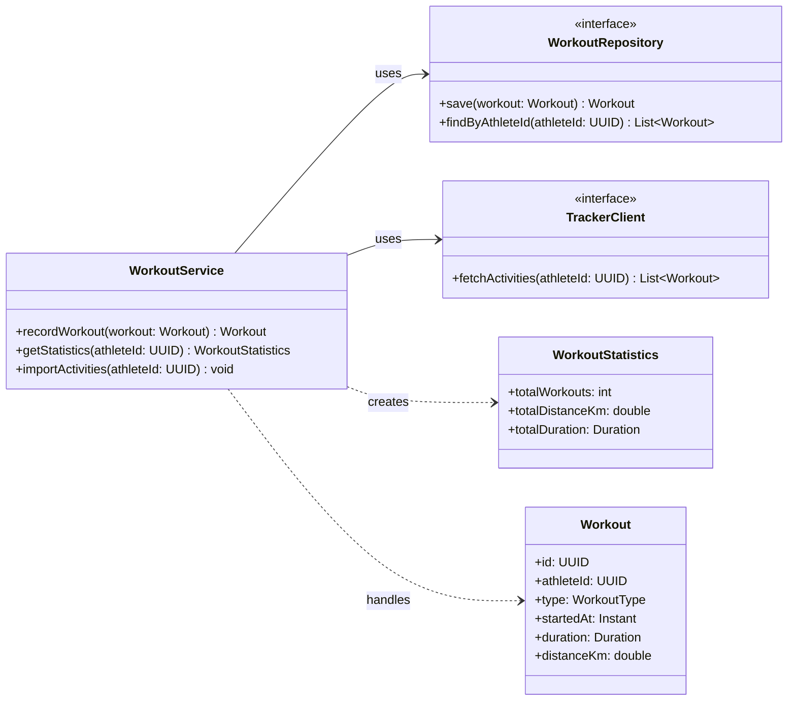

# Code Diagram

## What
A code diagram shows the internal code structure of a component [@brown2026, chap. 6].

## Audience 
Engineers [@brown2026, chap. 6, "Audience" section]

## Content 

The code diagram should "show the various code-level building blocks supported by the programming language being used" [@brown2026, chap. 6, "Content" section].

## Example

