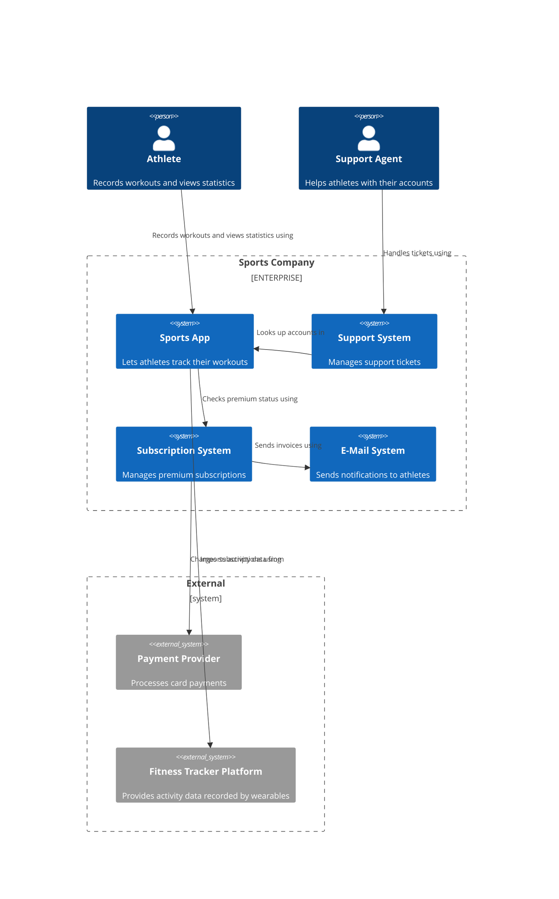

# System Landscape Diagram

## What
A system landscape diagram shows how multiple software systems work together. This is one level above the system context diagram[@brown2026, chap. 9].

## Audience 
Technical and non technical people, everybody involved in the project [@brown2026, chap. 9, "Audience" section]

## Content 

The diagram should show the software systems and people who use it [@brown2026, chap. 9, "Content" section].  

## Example

