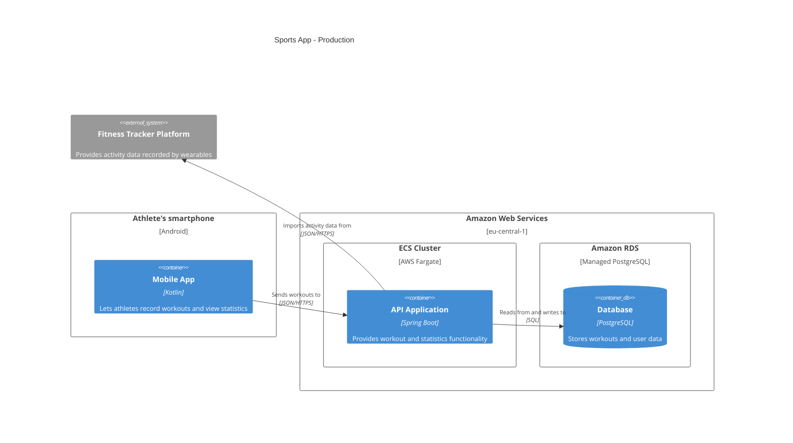

# Deployment Diagram

## What 

A deployment diagram is a "way to diagram the deployment topology" [@brown2026, chap. 8] for a software system. 

## Audience 

Engineers and software architects [@brown2026, chap. 8, "Audience" section].

## Content

### Container instances

The container instances inside the software system [@brown2026, chap. 8, "Container instances" section].

### Software system instances

Software system instances running outside of the current scope of the software system that interact with the current software system [@brown2026, chap. 8, "Software system diagram" section]. 

### Deployment nodes

A building block of infrastructure where a container is running [@brown2026, chap. 8, "Deployment nodes" section]. 

### Infrastructure nodes

An infrastructure node is a building block of infrastructure such as a load balancer or gateway [@brown2026, chap. 8, "Infrastructure nodes" section]. 

## Example

