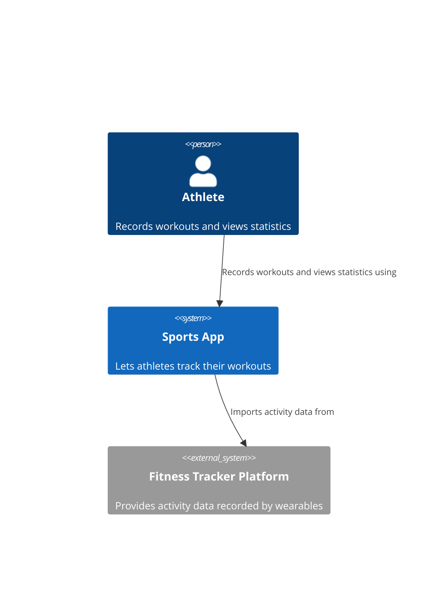
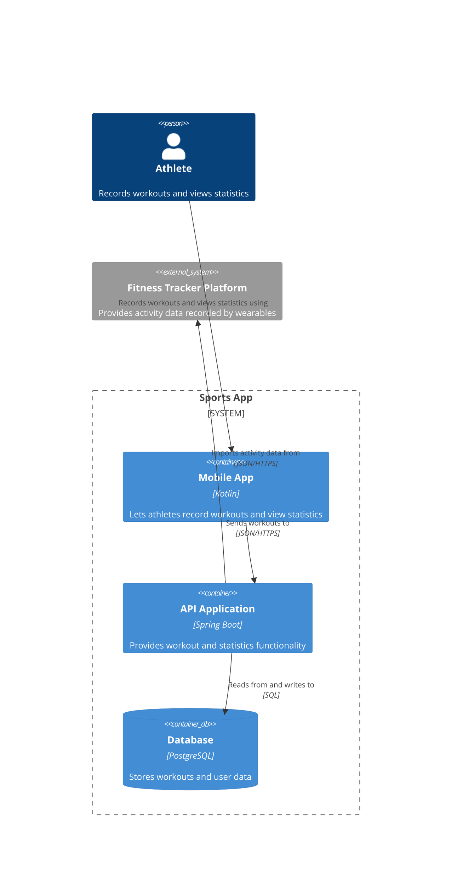

# C4

The C4 model consists of:

- Four hierarchical abstractions: software systems, containers, components and code [@brown2026, chap. 2]
- Four hierarchical diagrams: system context, containers, components and code [@brown2026, chap. 2]
- Three supporting diagrams: system landscape, dynamic and deployment [@brown2026, chap. 2, "Supporting Diagrams" section]

C4 is notation agnostic [@brown2026, chap. 2, "Notation" section] and tool agnostic [@brownc4model].

## Abstractions

### Software systems

A software system is something that delivers value to its users and is mostly developed by one team [@brown2026, chap. 2, "Software System" section].

### Containers

A container is a runnable unit. It is either an application or a data store [@brown2026, chap. 2, "Container" section].

### Components

A component groups related functionality inside a container with well-defined interfaces [@brown2026, chap. 2, "Component" section].

### Code

Code consists of the building blocks of the programming language like classes, interfaces or functions [@brown2026, chap. 2, "Code" section].

---

## System Context Diagram

### What
A system context diagram shows a single software system with people and software systems interacting with it in a high-level view [@brown2026, chap. 3].

### Audience 
Technical and non technical people, everybody involved in the project [@brown2026, chap. 3]

### Content 

Software systems, people and relationships [@brown2026, chap. 3, "Content" section]

#### People

People who are using the system (prefered from a functional perspective) labeled with a name and a description [@brown2026, chap. 3, "People" section].

#### Software systems

The software system that is described and the software systems that interact with it. Every software system, should be labeled with a name and a description [@brown2026, chap. 3, "Software systems" section].

#### Relationships

Relationships should be created as "unidirectional arrows, each labeled with a summary of the relationship" [@brown2026, chap. 3, "Relationships" section]. 

### Example

## Container Diagram

### What
A container diagram shows the containers of a single software system [@brown2026, chap. 4].

### Audience 

Software architects and engineers [@brown2026, chap. 4, "Audience" section]

### Content

#### People

People who are using a container of the software system (prefered from a functional perspective) labeled with a name and a description [@brown2026, chap. 4, "People and software systems" section].

#### Software Systems

The software systems that interact with a container of the software system [@brown2026, chap. 4, "People and software systems" section].

#### Containers

Applications and data stores that are needed in order to have a working system. Every container should have the following informations: Name, technology and description [@brown2026, chap. 4, "Containers" section].

#### Software system boundaries

The diagram should contain a box around containers to distinguish what is inside of the system [@brown2026, chap. 4, "Software system boundary" section].

#### Relationships

The diagram should contain unidirectional arrows between containers, people and outside software systems. Each arrow should be labeled with a description and where applicable the technology [@brown2026, chap. 4, "Relationships" section].

### Example

## Component diagram

### What
A component diagram shows the components of a single container in a software system [@brown2026, chap. 5].

### Audience 
Software architects and engineers [@brown2026, chap. 5, "Audience" section]

### Content 

#### People

The people that surround the container in the container diagram [@brown2026, chap. 5, "People, software systems, and containers" section].

#### Software Systems

The software systems that surround the container in the container diagram [@brown2026, chap. 5, "People, software systems, and containers" section].

#### Containers

The other containers that surround the container in the container diagram [@brown2026, chap. 5, "People, software systems, and containers" section].

#### Components

Components are the building blocks inside the container, each labeled with a name, technology and description. A component is a group of related code. The diagram should reflect the architectural style in use, e.g. components organized in layers or in a "ports and adapters" style [@brown2026, chap. 5, "Components" section]. 

#### Container boundary

A box that shows the container boundary around the components [@brown2026, chap. 5, "Container boundary" section]. 

#### Software system boundary (optional)

A box that shows the boundary of the parent software system to make the hierarchy of elements explicit [@brown2026, chap. 5, "Software system boundary" section]. 

#### Relationships

The diagram should contain unidirectional arrows between the components, containers, people and outside software systems. Each arrow should be labeled with a description and where applicable the technology. Component to component relationships with method and function calls do not need technology description [@brown2026, chap. 5, "Relationships" section]. 

